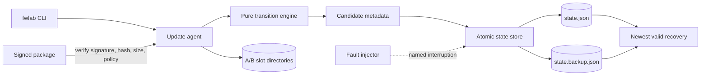

# Firmware Release & Recovery Lab

[](https://github.com/JasonStys/firmware-release-recovery-lab/actions/workflows/ci.yml)
[](https://github.com/JasonStys/firmware-release-recovery-lab/actions/workflows/codeql.yml)
[](https://github.com/JasonStys/firmware-release-recovery-lab/actions/workflows/security.yml)

A local desktop application and deterministic Rust simulator for reasoning about signed A/B firmware updates,
bounded trial boots, health confirmation, rollback, and interrupted durable writes. It
operates only on local directories and synthetic byte strings: it does not flash devices,
implement secure boot, download firmware, or access hardware.

The application lets a user edit fictional device inventories, build or import supported signed packages,
rehearse ordered lifecycle steps and metadata interruptions, compare actual before/after states,
review cohort readiness, and save or export the evidence. The Python owner window supplies a private
local workspace and opens the TypeScript interface in a browser. Every run invokes the original
compiled Rust engine; imported report claims are discarded and their input is executed again.

The [CodeQL analysis contract](docs/codeql-analysis.md) covers Rust, Python, TypeScript/JavaScript and
Actions with security-extended queries. Rust uses its supported no-build extraction alongside real
Cargo builds, tests and RustSec audit. Missing analysis is never treated as zero findings.

## Desktop application

The **0.2.1 source candidate** retains the full application and corrects an asynchronous evidence-import
status error: an import finishing during another active run is explicitly refused, without claiming
it was rerun. See the [correction and validation record](docs/reports/async-evidence-import-2026-11-11.md).
A downloadable release is pending review;
this README does not represent a local build as a published or signed installer. The native build
produces a Windows ZIP or a macOS/Linux tar.gz portable application, with hashes and exact source
provenance. Extract the complete archive into a new application directory before launching
`FirmwareRecoveryWorkbench.exe` on Windows or `FirmwareRecoveryWorkbench` on macOS/Linux.

1. Open the application, choose an empty or existing identified workspace, and select **Open workspace**.
2. Edit the device JSON, image bytes, release policy and ordered steps, or import your supported JSON/image files.
3. Run the rehearsal and inspect each actual generation, slot decision, rejection or interruption.
4. Export the selected input, signed demonstration package or evidence. Reopen the same workspace to review its history.

Healthy promotion, exhausted-trial rollback, interrupted metadata, fleet/cohort review and the
original campaign are editable options within the same application. They do not limit users to
fixed example cases. Malformed input is refused before a history record is created; an actual
blocked or interrupted rehearsal remains visible as evidence of that outcome.

The native window stays responsible for its loopback service and workspace lock until owned work
finishes. Use **Exit** or the browser's **Quit application** control; closing the browser tab alone
does not stop the app. There are no accounts, remote telemetry or cloud services. Workspace data
is ordinary local SQLite, protected by OS-user access rather than encryption from the PC owner.
See the [application guide](docs/native-application.md), [test evidence](docs/reports/native-application-2026-11-11.md)
and [native architecture decision](docs/adr-native-rehearsal-studio.md).

## 60-second quickstart

Prerequisites for the original CLI: Rust 1.98.1 (the toolchain file selects it) and Git.

```bash
cargo run -- init --root demo/device --version 1.0.0
cargo run -- package --output demo/release-2 --version 2.0.0 --release-id release-2.0.0
cargo run -- stage --root demo/device --package demo/release-2
cargo run -- activate --root demo/device --slot B --attempts 2
cargo run -- boot --root demo/device
cargo run -- confirm --root demo/device
cargo run -- status --root demo/device --json
```

Run every validation gate and a 1,200-scenario interruption campaign:

```bash
bash scripts/validate.sh
```

## Why this project exists

Release engineers can now run a **read-only fleet preflight** before staging:
verify one signed package against explicit device policies/snapshots and rehearse
ordered canary cohorts with declared confirmation or exhausted-trial outcomes.
Blocked/rolled-back cohorts stop later rehearsal while all compatibility results
remain visible. Hash-bound JSON records exactly which inputs were reviewed.
See the [complete fleet workflow and sample plan](docs/fleet-preflight.md).
This does not change device state or measure real health. Activation also enforces
the signed boot ceiling, rejects trial-budget resets and prevents selection of an
older previously verified image; rejected staging preserves existing slot bytes.

An update system is credible only if its failure behavior is explicit. This lab makes four
invariants executable and reviewable:

1. Unverified content is never selected for boot.
2. The last health-confirmed image remains available during an update.
3. Trial boots have a bounded attempt budget and deterministic rollback.
4. A restart after any modeled metadata-write interruption loads either the prior valid
   state or the synchronized next state.

The result is a compact portfolio project about reliability engineering, not a claim of
production bootloader or hardware-security expertise.

## Major features

| Feature                | What it demonstrates                                                                                               |
| ---------------------- | ------------------------------------------------------------------------------------------------------------------ |
| Signed packages        | Canonical JSON metadata, SHA-256 image binding, and Ed25519 verification before staging                            |
| Compatibility policy   | Hardware allowlist, schema version, image size, boot-attempt bounds, and monotonic version floor                   |
| Pure transition engine | Stage, activate, select boot, confirm health, fail health, and rollback without filesystem coupling                |
| Durable state adapter  | Synchronized temporary write, prior-state recovery copy, rename, validation, and newest-valid generation selection |
| Fault injection        | Six named commit boundaries exercised during both stage and activation                                             |
| Auditability           | Monotonic generations and bounded causal event history persisted with each transition                              |
| CLI                    | Human-readable status plus JSON output for automation and evidence capture                                         |
| Verification           | Unit, integration, property, tamper, recovery, Clippy, rustfmt, docs, and dependency-advisory gates                |
| Editable desktop studio | Custom devices, image import, signed-package inspection, ordered steps and six named metadata interruptions |
| Durable local history | Literal title/type search, paging, selected input/evidence/package exports and explicit record deletion |
| Owned native lifecycle | Patched Python runtime, private capability-bound loopback UI, single-owner workspace and completion-based Exit |

## Architecture



The transition engine owns policy; the store owns durability mechanics; the agent performs
ordered orchestration. See [architecture](docs/architecture.md), [state machine](docs/state-machine.md),
and [durable-write model](docs/durable-writes.md).

## Failure demonstration

To force automatic rollback, initialize and stage as above, activate with one attempt, then:

```bash
cargo run -- boot --root demo/device
cargo run -- fail --root demo/device --reason "watchdog deadline expired"
cargo run -- status --root demo/device --json
```

The selected slot returns to A, slot A remains confirmed, and the persisted audit entry
explains why slot B was rejected.

## Tests and evidence

`cargo test --all-targets --locked` currently covers:

- strict version parsing and invariant validation;
- image tampering, invalid signatures, and incompatible hardware;
- successful confirmation and exhausted-attempt rollback;
- primary/backup recovery at each durable metadata boundary;
- public API behavior across process-like agent restarts;
- property-generated versions and attempt budgets; and
- repeated stage/activation interruption campaigns.

GitHub Actions rebuilds the release binary, denies compiler and Clippy warnings, regenerates
the exact declaration index, audits dependencies, and uploads the campaign JSON. Local
results are recorded in [the validation report](docs/reports/validation.md); the test
strategy explains coverage and exclusions.

## Security and safety boundaries

- The repository's signing seed is intentionally public and **must never** protect a real
  release. It exists only to make examples reproducible.
- The simulator does not model a ROM root of trust, protected key storage, anti-rollback
  fuses, recovery authentication, measured boot, encrypted transport, or physical attacks.
- Package paths are provided by the operator, while internal slot and state paths are fixed
  below the selected lab root.
- No command contacts a device or network endpoint.

See [SECURITY.md](SECURITY.md), [threat model](docs/threat-model.md), and
[known limitations](docs/limitations.md) before adapting any idea to real systems.

## Repository guide

| Area                | Summary                                                                          |
| ------------------- | -------------------------------------------------------------------------------- |
| `src/model.rs`      | Persisted types, strict versions, slot identities, audit records, and invariants |
| `src/package.rs`    | Canonical manifests, package I/O, policy checks, signature/digest verification   |
| `src/preflight.rs` | Bounded read-only fleet compatibility, input fingerprints and cohort rehearsal |
| `src/transition.rs` | Side-effect-free lifecycle decisions                                             |
| `src/store.rs`      | Simulated slots and recoverable metadata commits                                 |
| `src/fault.rs`      | Named one-shot interruption injection                                            |
| `src/agent.rs`      | Ordered orchestration and campaign reporting                                     |
| `src/main.rs`       | `fwlab` command definitions and output                                           |
| `tests/`            | Property and persisted end-to-end behavior                                       |
| `tests/preflight.rs` | Actual CLI, cohort-stop, file-preservation, signed-ceiling and downgrade regressions |
| `docs/fleet-preflight.md` | Realistic sample inventory, outcomes, migration and bounds |
| `docs/reports/practical-workflows-2026-11-09.md` | Point-in-time native validation and known limits |
| `scripts/`          | Local/CI validation, source-header checks, and exact code indexing               |
| `docs/`             | Architecture, decisions, safety analysis, operations, tests, and evidence        |
| `.github/`          | Read-only CI/security workflows and dependency maintenance                       |

Every original file is summarized in [the repository map](docs/repository-map.md), every code file
in the generated [source file guide](docs/source-file-guide.md), and exact
function/type locations are generated in [the code index](docs/code-index.md).

## Complexity and performance

- Version, policy, and state transition checks are `O(h)` for `h` compatible hardware IDs;
  slot access is `O(log 2)`, effectively constant.
- Hashing and package verification are `O(n)` in image bytes, which is unavoidable for full
  integrity verification.
- Recovery examines two bounded metadata files: `O(1)` file count and `O(m)` JSON bytes.
- Audit storage is capped at 128 events so state size and commit time remain bounded.

Measured campaign timing is machine-dependent and is reported as evidence, not a real-time
guarantee.

## Development

```bash
cargo fmt --all -- --check
cargo clippy --all-targets --all-features -- -D warnings
cargo test --all-targets --all-features --locked
cargo doc --no-deps --document-private-items --locked
python scripts/verify_repo.py
```

For the application use Python 3.14.10 or later final 3.14, Node 24 and the pinned Rust toolchain:

```bash
python -m pip install --require-hashes -r requirements-dev.lock -r requirements-package.lock
cargo build --locked
npm --prefix web ci --ignore-scripts
npm --prefix web test
npm --prefix web run smoke
python -m pytest --cov --cov-report=term-missing
python launcher.py
```

`python -m tools.package_app --output-root .runtime/native-build` requires a clean source checkout,
builds the actual engine/UI, collects runtime and target-resolved crate notices, safely extracts the
archive and runs the actual compiled GUI workflows plus a second-launch history check. It refuses
to overwrite existing output. Linux GUI tests require an actual display or `xvfb-run`; browser
acceptance also requires the locked Chromium installation. See [testing](docs/testing.md).

Contributions follow [CONTRIBUTING.md](CONTRIBUTING.md). Design choices are captured as ADRs,
starting with [Rust for the state engine](docs/adr/0001-rust-state-engine.md) and
[recoverable JSON metadata](docs/adr/0002-recoverable-json-metadata.md).

The [latest maintenance audit](docs/reports/maintenance-audit-2026-09-18.md) records the current
hosted verification and dependency review.

## License

Authored source is MIT; see [LICENSE](LICENSE). Portable packages also contain actual Python,
Tcl/Tk, PyInstaller, Rust standard-library and resolved Cargo dependency notices. Their separate
terms and source identities are retained; this is not a claim that every bundled component is MIT.

## Documentation editions

Start with the [organized handbook](docs/handbook.md) for current usage, design, security and test guidance. Reviewed downloadable editions: [project-guide.docx](docs/reports/project-guide.docx) · [validation-review.docx](docs/reports/validation-review.docx) · [validation-evidence.xlsx](docs/reports/validation-evidence.xlsx).

[Publication identities and source scope](docs/reports/publications.json) · [Documentation validation record](docs/reports/documentation-refresh-2026-11-09.md). Historical results retain their own tested revision and date.
